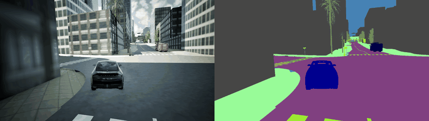
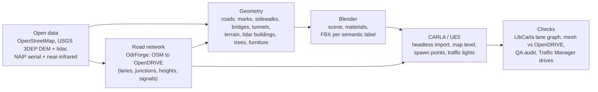
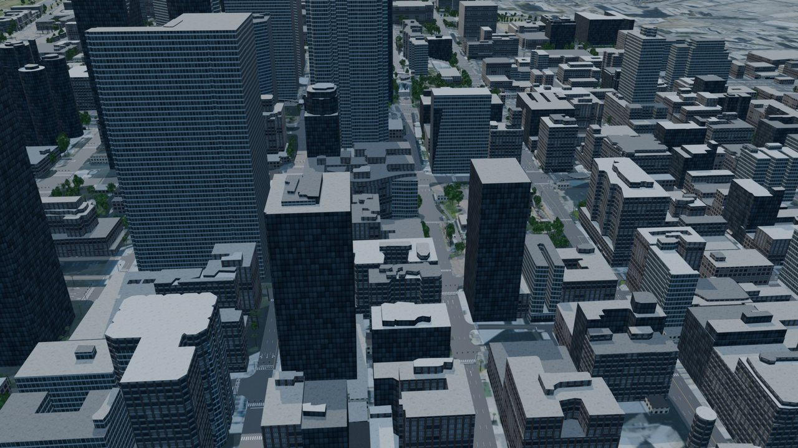
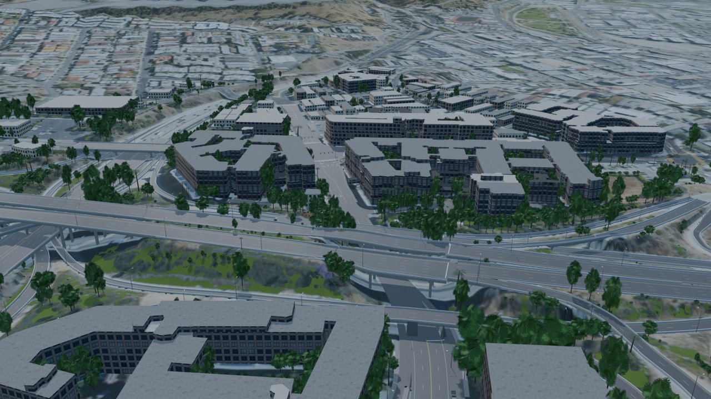
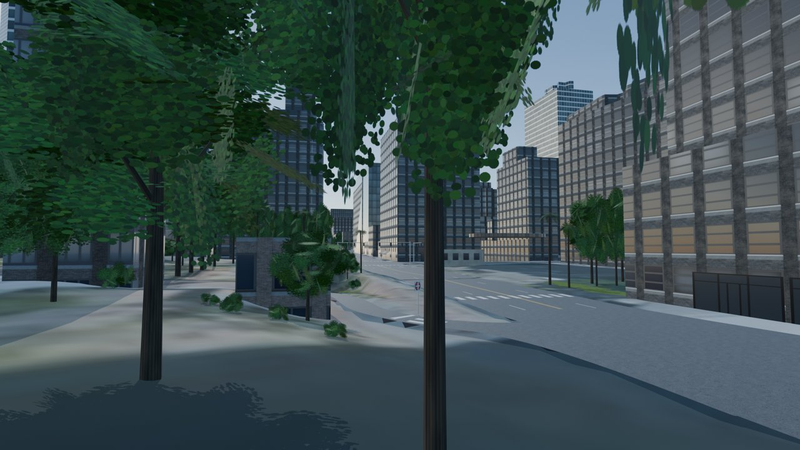
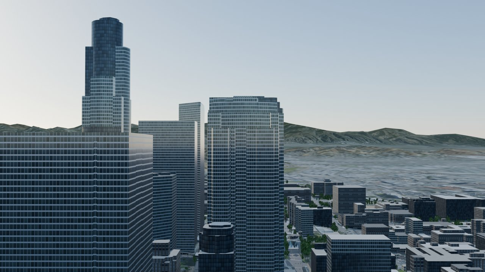
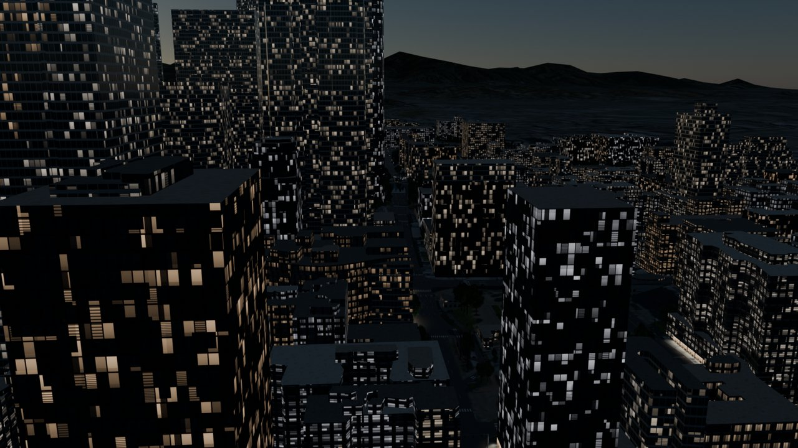
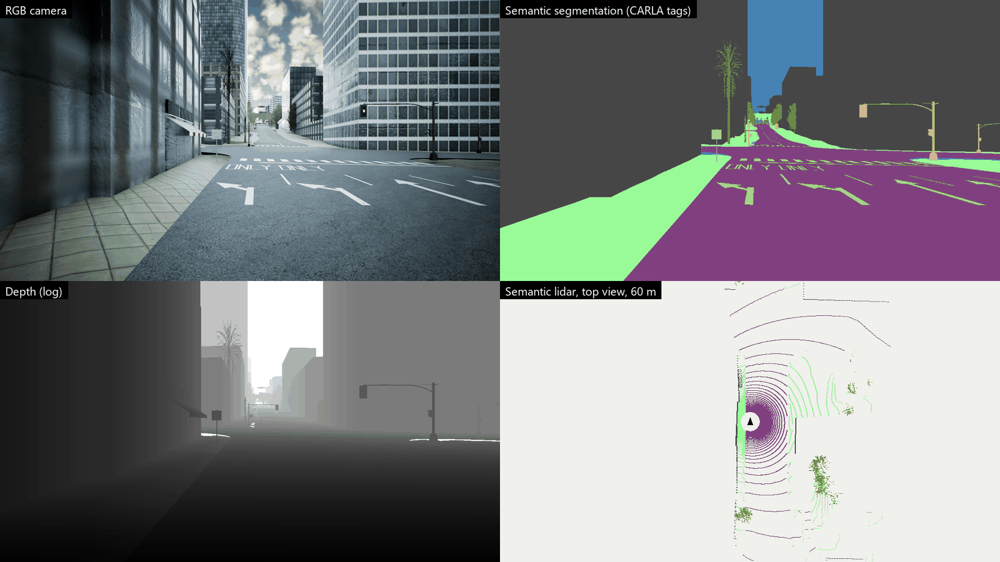
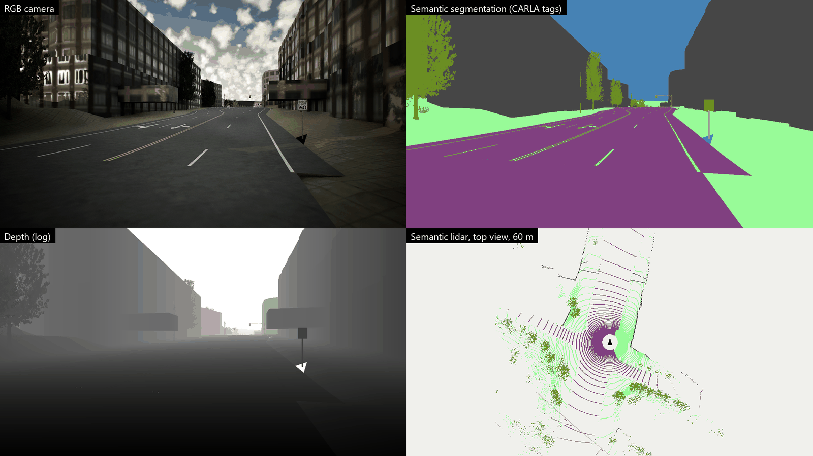

# MirrorMile

**Real streets, mirrored mile for mile into simulation.**

MirrorMile builds simulation-ready digital twins of real cities from open geodata: a lane-accurate
OpenDRIVE road network with measured elevation, plus matching 3D meshes for roads, markings,
sidewalks, bridges, tunnels, buildings, vegetation, street furniture and surrounding terrain,
packaged for driving simulators.



*Downtown Los Angeles (2.6 × 2.5 km) in CARLA (UE5): a car driven by CARLA's Traffic Manager, filmed by a chase
camera (left) and a semantic-segmentation camera at the same pose (right). Everything in the picture except the cars, sky,
trees, traffic lights and streetlights (CARLA's own assets) was generated by MirrorMile from open data. 12 s of
driving in synchronous mode (20 Hz, every third frame shown), weather sun set to 55° for the recording.*

> Status: active development.

## Workflow



1. **Fetch** (`01*`): OpenStreetMap, USGS 3DEP elevation and lidar point cloud, NAIP aerial and near-infrared imagery.
2. **Road network** (`02_odrforge_xodr.py`, `02g`): [OdrForge](https://github.com/sagar-g-v/odrforge) turns the OSM
   streets into OpenDRIVE with the lidar ground as road elevation; bridge / tunnel levels and highway classes are read
   back from the file. (`run_all.ps1` keeps the older SUMO `netconvert` route.)
3. **Geometry** (`03*`, `04*`): road, sidewalk and junction surfaces from the OpenDRIVE lanes, lane markings and
   pavement legends, bridges and tunnels, terrain from the DEM, building massing from lidar roof heights (stacked
   tiers for towers), roof materials, trees from lidar + NDVI, storefronts from OSM businesses, street furniture,
   textures and a ground-cover mask.
4. **Blender** (`05_blender_build.py`): one scene, PBR materials, one FBX per CARLA semantic label.
5. **CARLA** (`06_ue_import_carla.py`, headless): meshes into `/Game/Carla/Static/<Label>/` (so CARLA's tagger labels
   them), the map level from CARLA's BaseMap, the OpenDRIVE file, spawn points, CARLA traffic lights / signs /
   streetlights at their real positions, weather and night lighting.
6. **Checks**: the lane graph through LibCarla, meshes against the OpenDRIVE surface, a QA audit (cracks, holes,
   overlaps, clearance, paint), and Traffic Manager drives.

```powershell
.\run_odrforge.ps1            # 02 .. 05 with OdrForge; then 06 in UnrealEditor-Cmd (see the script header)
```

The map area and name are set in `scripts/config.py`.

## In pictures

All pictures are of the Downtown Los Angeles map (2.6 × 2.5 km, 5.2 million triangles) as built on 2026-10-24.

**Blender scene** (`05_blender_build.py` preview renders, Eevee):

| | |
|---|---|
|  |  |
| Downtown from above: 2,561 buildings with lidar-measured heights (547 with stacked roof tiers); low roofs take the material closest to their colour in the aerial photo | The 4-level interchange: OpenDRIVE bridges and ramps at their measured heights, trees placed from lidar |
|  |  |
| Street level: 11,940 detected trees (palms and broadleaf, scaled to their lidar height and crown) | The skyline against the surrounding terrain (USGS DEM, 35 km, earth curvature included) |



*Night: lit windows per building, 376 named storefronts and 768 lit ground-floor bays from OSM businesses,
460 streetlights.*

**CARLA sensors.** A static sensor rig 2 m above the lane, all CARLA's stock sensors: RGB camera, semantic
segmentation (the meshes carry CARLA's semantic tags through their folder), depth, and semantic lidar (64 channels,
80 m) seen from above, coloured by tag.





## Measured

| | |
|---|---|
| Map | 2.58 × 2.51 km, 5.23 M triangles in step 03, 2,265 vehicle spawn points |
| Street furniture | 567 traffic-light poles (1,422 heads), 25 stop signs, 460 streetlights (275 on freeways) |
| Build time (2026-10-24, 20 logical cores) | 03 geometry 218 s · 03b vegetation 94 s · 03d / 03e / 03f / 04b 12 / 9 / 7 / 10 s · mesh check 6 s · 05 Blender 245 s (with 8 preview renders): 601 s for steps 03 – 05; headless CARLA import 169 s |
| Driving | CARLA's Traffic Manager, 60 vehicles, 3,000 ticks, 5 seeds (`run_drive_test.ps1`): no route crashes with the route guard in the [CARLA fork](https://github.com/sagar-g-v/carla) (branch `tm-importpath-guard`); stock CARLA's Traffic Manager crashed on 3 of the 5 seeds on this map |

## Compatibility

| Target | Support |
|---|---|
| **CARLA** (UE5 `ue5-dev`; OpenDRIVE maps for CARLA 0.9.x) | OpenDRIVE + FBX per semantic label, import script for the Unreal Editor, spawn points, traffic lights / stop signs / speed limits as OpenDRIVE signals |
| **OpenDRIVE** | Lanes, junctions, elevation profiles, speed limits, traffic-light controllers, stop and speed-limit signals |
| **Unreal Engine 5** | FBX meshes with PBR materials, semantic folder layout (Road, RoadLine, SideWalk, Building, Vegetation, Terrain, Bridge, GuardRail, Wall, Pole, TrafficSign) |
| **Blender 5.x** | Full scene build, previews and FBX export |
| **SUMO 1.28** | Network conversion (`netconvert`), the older road-network route |

## Requirements

- Python 3.12+ (`pip install -r requirements.txt`), Python 3.8 environment with the `carla` wheel for validation
- Blender 5.x, CARLA UE5 editor build (for the import step), OdrForge (`ODRFORGE_EXE`, default its Release build)

## Data and licensing

Generated maps contain third-party data with attribution and share-alike obligations; see
[NOTICE.md](NOTICE.md). The MirrorMile source code is proprietary; see [LICENSE](LICENSE).
Map data © OpenStreetMap contributors (ODbL); elevation and lidar: USGS 3DEP; imagery: USDA NAIP.
